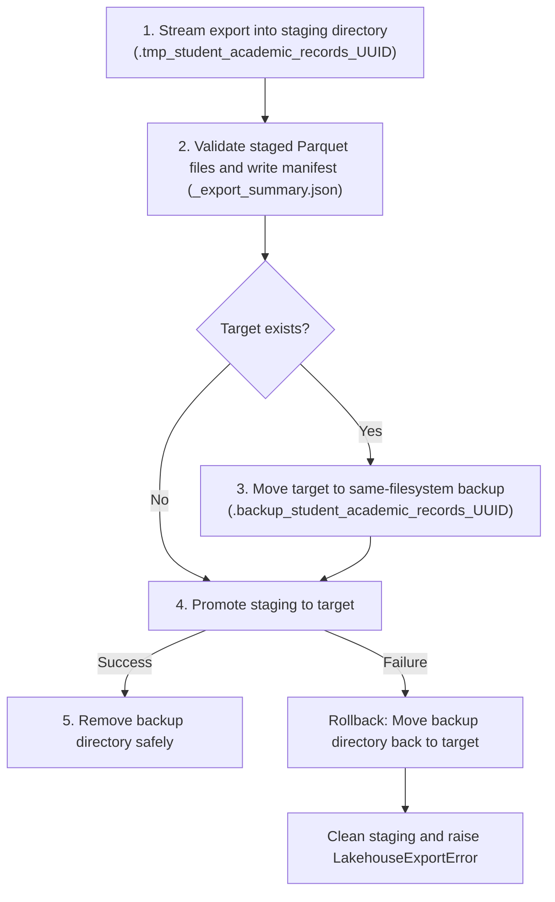

# EduPredict — Analytical Lakehouse Parquet Export Bridge (Phase 7E.1)

The **Parquet Lakehouse Export Bridge** provides reliable, memory-bounded, and recoverable serialization of academic records from MongoDB 6.x into partitioned Apache Parquet files for the EduPredict Analytical Lakehouse.

---

## 1. Architecture & Design

### 1.1 Target Schema
The output Parquet dataset maps 1:1 with the Apache Impala Lakehouse table DDL specified in `analytics/impala/01_create_academic_lakehouse_tables.sql`:

- **Database**: `edupredict_lakehouse`
- **Table**: `student_academic_records`
- **File Format**: Apache Parquet (`STORED AS PARQUET`)
- **Compression**: `SNAPPY` (`TBLPROPERTIES ('parquet.compression'='SNAPPY')`)
- **Partitioning Columns**:
  - `subject` (e.g. `Mathematics`, `Portuguese Language`)
  - `academic_year` (e.g. `2024-2025`, `2025-2026`)

### 1.2 Storage Layout
Parquet files are organized according to standard Hive directory partitioning outside the frontend public directory:

```
data/lakehouse/student_academic_records/
├── _SUCCESS
├── _export_summary.json
├── subject=Mathematics/
│   ├── academic_year=2024-2025/
│   │   └── part-0.parquet
│   └── academic_year=2025-2026/
│       └── part-0.parquet
└── subject=Portuguese Language/
    └── academic_year=2025-2026/
        └── part-0.parquet
```

Internal MongoDB identifiers (`_id`) are excluded during extraction to ensure clean relational and columnar interoperability.

---

## 2. Bounded-Memory Incremental Streaming

To prevent memory exhaustion when processing large institutional datasets:
- The exporter processes MongoDB cursor records incrementally in batches bounded by the configured `batch_size` (default: 500).
- Records are validated, normalized, and yielded as PyArrow `RecordBatch` objects via `pyarrow.RecordBatchReader`.
- `pyarrow.dataset.write_dataset()` consumes batches directly from the reader stream, writing them to disk without loading the full collection into RAM.
- Memory consumption remains strictly bounded by `batch_size` records throughout the export lifecycle.
- **Bounded Rejected Records**: Rejected/invalid documents are counted using an integer counter (`rejected_records`) without accumulating entire documents in memory. A small, fixed diagnostic sample (`MAX_REJECTED_SAMPLES = 20`) is retained for operator triage, ensuring memory usage is strictly $O(1)$ with respect to invalid records.

---

## 3. Strict Numeric Validation & Integrity Rules

Every record is evaluated through strict validation rules prior to inclusion:
1. **NaN and Infinity Rejection**:
   - Floating-point fields (`attendance_percentage`, `previous_exam_marks`, `quiz_scores`, `final_exam_marks`, `study_hours_per_week`, `assignment_completion_rate`) strictly reject `NaN`, `+Infinity`, and `-Infinity`.
2. **Fractional Value Rejection for Integer Fields**:
   - Integer schema fields (`age`, `failures`, `absences`, `mother_education`, `father_education`, `family_relationship`, `free_time`, `go_out`, `health`) strictly reject fractional values (e.g. `16.5`, `3.14`).
   - Whole numbers represented as integer floats (`16.0`) or strings (`"16"`) are safely converted to 32-bit signed integers.
3. **Domain Bounds**:
   - Examination marks and attendance percentages are enforced within $[0.0, 100.0]$.
   - Study hours, failures, absences, and age cannot be negative.
   - `academic_status` must be one of `"High Risk"`, `"Moderate Risk"`, `"Low Risk / On Track"`.

---

## 4. Safe Dataset Replacement & Rollback Guarantees

### Filesystem Semantics & Replacement Strategy
On POSIX systems, directory renames within the same filesystem mount are atomic. On Windows NTFS, directory renames cannot overwrite an existing destination folder. To ensure non-destructive updates and disaster recovery across all platforms, the exporter employs a **same-filesystem transactional workflow**:



### Guarantees Provided:
- **No Premature Deletion**: The previous valid dataset is preserved intact in backup until the new dataset is fully validated and promoted.
- **Automatic Rollback**: If staging promotion fails (e.g., due to filesystem locks), the backup is immediately restored to the target path.
- **Non-Destructive Rollback Failure**: If rollback restoration also fails, the backup directory is **NEVER deleted**. It remains intact on disk, a CRITICAL-level error is logged, and the exact backup path is reported in `LakehouseExportError` for manual operator recovery.
- **Fail-Safe Cleanup**: Temporary staging (`.tmp_*`) directories are unconditionally purged in `finally` blocks, while un-restored backup directories are strictly preserved.
- **Repeatability Guard**: If `overwrite=False` and the target directory already contains Parquet files, `FileExistsError` is raised to prevent accidental overwrites.

---

## 5. Configuration Options

Configured in `backend/config.py` with environment variable overrides:

| Configuration Variable | Environment Variable | Default Value | Description |
| :--- | :--- | :--- | :--- |
| `LAKEHOUSE_PARQUET_DIR` | `LAKEHOUSE_PARQUET_DIR` | `data/lakehouse/student_academic_records` | Root destination directory for partitioned Parquet output. |
| `LAKEHOUSE_EXPORT_BATCH_SIZE` | `LAKEHOUSE_EXPORT_BATCH_SIZE` | `500` | Maximum in-memory record batch size during cursor streaming. |

---

## 6. How to Run the Export

### A. Via Command-Line Interface (CLI)

```powershell
# Standard export with safe overwrite
.\.venv\Scripts\python.exe -m backend.data_engineering.parquet_exporter --overwrite

# Custom batch size (bounded memory)
.\.venv\Scripts\python.exe -m backend.data_engineering.parquet_exporter --batch-size 250 --overwrite

# Custom target directory
.\.venv\Scripts\python.exe -m backend.data_engineering.parquet_exporter --output-dir data/lakehouse/custom_export --overwrite
```

### B. Programmatically via Python API

```python
from backend.app import create_app
from backend.extensions import mongo
from backend.data_engineering.parquet_exporter import export_mongodb_to_parquet

app = create_app("development")
with app.app_context():
    summary = export_mongodb_to_parquet(
        db=mongo.db,
        batch_size=500,
        overwrite=True,
    )
    print(f"Exported {summary['valid_records_exported']} records across {summary['partition_count']} partitions.")
```

### C. Programmatically via Service Layer

```python
from backend.services.lakehouse_service import LakehouseService

service = LakehouseService(db=mongo.db)
summary = service.export_academic_lakehouse(overwrite=True)
```
