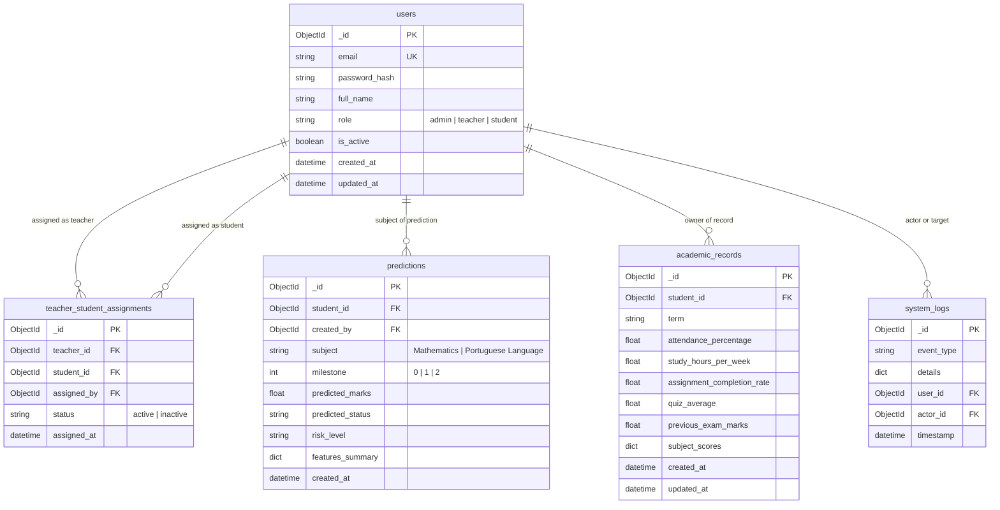
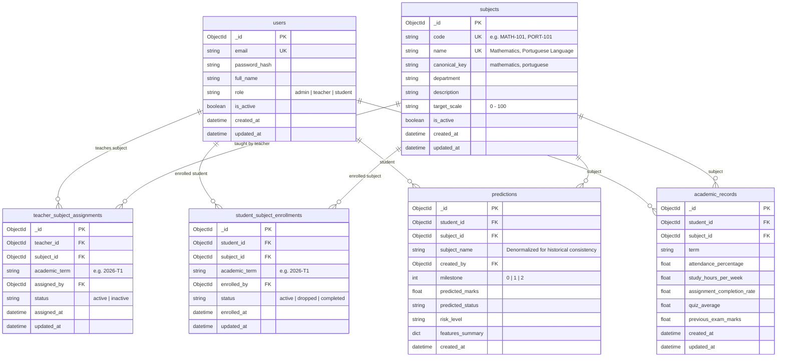
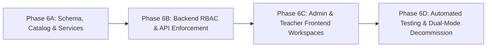

# EduPredict — Subject-Based Teacher Assignment Architecture Audit

> **Document Type**: System Architecture Specification & Security Vulnerability Assessment  
> **Status**: APPROVED READ-ONLY ARCHITECTURAL AUDIT  
> **Repository**: `C:/Users/Azan's PC/Documents/EduPredict`  
> **Audited Baseline**: Phase 5D-F (`af55085`, `ee036fb`)  
> **Target Scope**: Architectural Blueprint for Subject-Based Multi-Tenancy & Authorization  

---

## Executive Summary

Currently, **EduPredict** implements a **flat binary teacher-to-student assignment model** through the MongoDB collection [`teacher_student_assignments`](file:///C:/Users/Azan's%20PC/Documents/EduPredict/backend/models/assignment_model.py#L11-L63). When an administrator assigns a student to a teacher, that teacher obtains unfettered read and prediction access to that student across **all academic domains and subjects**.

In production education settings, faculty specialization requires **subject-based boundaries**:
- An administrator assigns one or multiple academic subjects (e.g., Mathematics, English, Portuguese Language, Physics) to each teacher.
- A student is enrolled in a specific subset of academic subjects.
- A teacher can access, evaluate, and generate ML predictions for a student **strictly within the subjects assigned to that teacher**.
- A student accesses their own profile, risk status, and predictions across **all their enrolled subjects**.
- Administrators retain authorized institutional access across all subjects, teachers, and students.
- All authorization boundaries must be strictly enforced at the **Flask backend service and database query layer**, preventing Insecure Direct Object References (IDOR) and cross-subject data leakage.

This document presents a comprehensive, strictly **read-only** audit of the current architecture, details existing security vulnerabilities, defines the proposed relational schema and backend RBAC model, outlines frontend workspace modifications, and provides an idempotent migration and rollback plan.

---

## 1. Current Architecture Findings

### 1.1 Existing MongoDB Collections & Schemas

The current database architecture in [`backend/database/schema.py`](file:///C:/Users/Azan's%20PC/Documents/EduPredict/backend/database/schema.py#L25-L103) relies on six primary collections:
1. `users`: Stores user identity, authentication hashes, and roles (`admin`, `teacher`, `student`).
2. `teacher_student_assignments`: Maps `teacher_id` directly to `student_id` with a compound unique index `("teacher_id", "student_id")`.
3. `academic_records`: Stores term-level academic indicators with an embedded `subject_scores` dictionary (`{"Mathematics": 78.0, ...}`).
4. `predictions`: Stores ML inference records with a string property `subject` (`"Mathematics"` or `"Portuguese Language"`).
5. `system_logs`: Immutable audit trails.
6. `analytical_academic_records`: Big Data staging collection.

#### The `teacher_student_assignments` Document Model
In [`backend/models/assignment_model.py`](file:///C:/Users/Azan's%20PC/Documents/EduPredict/backend/models/assignment_model.py#L32-L40), each mapping document is defined as:
```json
{
  "_id": "ObjectId('67390a1f...')",
  "teacher_id": "ObjectId('67390a1e...')",
  "student_id": "ObjectId('67390a1d...')",
  "assigned_by": "ObjectId('67390a1c...')",
  "status": "active",
  "assigned_at": "2026-11-17T08:00:00Z"
}
```
**Key Defect**: The schema contains zero subject attributes. The assignment implies total instructional custody.

### 1.2 Assignment Service Mechanics

In [`backend/services/assignment_service.py`](file:///C:/Users/Azan's%20PC/Documents/EduPredict/backend/services/assignment_service.py#L78-L112):
```python
@staticmethod
def get_students_for_teacher(db: Database, teacher_id) -> list[dict]:
    cursor = db.teacher_student_assignments.find({
        "teacher_id": t_oid,
        "status": "active",
    })
    student_ids = [doc["student_id"] for doc in cursor if "student_id" in doc]
    student_docs = db.users.find({"_id": {"$in": student_ids}, "role": "student"})
    return [User.from_doc(doc).to_dict() for doc in student_docs if doc]
```
The query retrieves all students linked to the teacher. Neither the assignment nor the student user record indicates which curriculum or course connects the teacher to the student.

### 1.3 String-Based Subject Representations

Across the application, subjects are not managed entities with unique database identifiers. Instead, they are represented as string literals:
- In [`backend/ml/model_loader.py`](file:///C:/Users/Azan's%20PC/Documents/EduPredict/backend/ml/model_loader.py#L18-L32): Valid subjects are hardcoded to `{"mathematics": "Mathematics", "portuguese": "Portuguese Language"}`.
- In [`backend/models/prediction_model.py`](file:///C:/Users/Azan's%20PC/Documents/EduPredict/backend/models/prediction_model.py#L22): `self.subject = subject.strip()`.
- In [`frontend/src/types/index.ts`](file:///C:/Users/Azan's%20PC/Documents/EduPredict/frontend/src/types/index.ts#L53): `export type PredictionSubject = 'Mathematics' | 'Portuguese Language';`.

There is currently no database collection for `subjects`, no catalog of subject metadata (such as subject code, department, credit hours, or active status), and no collection for `student_enrollments`.

### 1.4 Critical Authorization Gap in `can_access_student_data`

The foundational RBAC check in [`backend/utils/decorators.py`](file:///C:/Users/Azan's%20PC/Documents/EduPredict/backend/utils/decorators.py#L52-L86) demonstrates the vulnerability:
```python
def can_access_student_data(actor_user, student_id, db) -> bool:
    ...
    # 3. Teacher can only access students assigned to them
    if actor_role == "teacher":
        teacher_oid = to_object_id(actor_user.id)
        assignment = db.teacher_student_assignments.find_one({
            "teacher_id": teacher_oid,
            "student_id": target_oid,
            "status": "active",
        })
        return assignment is not None
```
**Vulnerability Identified**: The function evaluates access at the **student level only**. It takes no `subject` parameter.
1. When Teacher A (a Mathematics teacher) invokes `GET /api/predictions/<prediction_id>` to view a Portuguese prediction record generated for Student Ali, [`backend/services/prediction_service.py`](file:///C:/Users/Azan's%20PC/Documents/EduPredict/backend/services/prediction_service.py#L295-L298) verifies whether Ali is assigned to Teacher A.
2. Because Ali is in `teacher_student_assignments` for Teacher A, `can_access_student_data` returns `True`.
3. Teacher A successfully reads Student Ali's Portuguese Language predictions, marks, and risk profiles.
4. When Teacher A runs `GET /api/predictions`, [`PredictionService.list_predictions`](file:///C:/Users/Azan's%20PC/Documents/EduPredict/backend/services/prediction_service.py#L336-L341) finds all students assigned to Teacher A and queries `db.predictions.find({"student_id": {"$in": assigned_student_ids}})`. If Teacher A does not pass an explicit `?subject=` filter, Portuguese predictions are returned in the response payload.
5. In [`PredictionService.create_prediction`](file:///C:/Users/Azan's%20PC/Documents/EduPredict/backend/services/prediction_service.py#L220-L229), a Mathematics teacher can supply `"subject": "Portuguese Language"` in the POST body; the backend verifies that the student is assigned to the teacher and proceeds to generate a Portuguese ML prediction.

---

## 2. Current Database Relationship Diagram (As-Is)

The diagram below reflects the **existing implemented architecture**:



### Key Limitations of the Current Model
1. **No Subject Entity**: Subjects exist only as ephemeral strings inside records and ML loaders.
2. **Binary Linkage**: A teacher either has access to everything for a student or nothing.
3. **Implicit Over-Privilege**: Teacher specialization is completely absent in the persistence and security tiers.

---

## 3. Proposed Subject-Based Relationship Diagram (Target)

The proposed architecture introduces **First-Class Academic Subjects** and separates **Teacher Course Authorization** from **Student Course Enrollment**:



### Relational Dynamics in the Target Architecture
1. **Teacher Authorization Domain**: Teacher $T$ can access Student $S$ if and only if:
   $$\exists \text{ subject } X \text{ such that } (T, X) \in \text{teacher\_subject\_assignments} \land (S, X) \in \text{student\_subject\_enrollments}$$
2. **Subject Scoping Rule**: When Teacher $T$ accesses Student $S$'s data, Teacher $T$ can only view records where $\text{record.subject\_id} = X$.
3. **Student Multi-Tenancy**: Student $S$ enrolled in Math, Portuguese, and Physics can see all three subjects on their personal portal.
4. **Administrator Omniscience**: Administrators retain uninhibited read/write across all subjects and users.

---

## 4. Required Schema Changes

To transition from the binary model to the subject-based model without data loss or performance degradation, the following MongoDB collections and indexes are required.

### 4.1 Collection 1: `subjects`
Stores the canonical registry of academic curricula.

```json
{
  "_id": "ObjectId",
  "code": "MATH-101",
  "name": "Mathematics",
  "canonical_key": "mathematics",
  "department": "STEM",
  "description": "Secondary education core mathematics curriculum",
  "target_scale": "0 - 100",
  "is_active": true,
  "created_at": "ISODate",
  "updated_at": "ISODate"
}
```

#### Required Indexes
- `idx_subjects_code_unique`: `{"code": 1}`, `unique=True`
- `idx_subjects_canonical_unique`: `{"canonical_key": 1}`, `unique=True`
- `idx_subjects_active`: `{"is_active": 1}`

### 4.2 Collection 2: `teacher_subject_assignments`
Maps an instructor to one or more subjects they are certified and assigned to teach.

```json
{
  "_id": "ObjectId",
  "teacher_id": "ObjectId",
  "subject_id": "ObjectId",
  "academic_term": "2026-T1",
  "assigned_by": "ObjectId",
  "status": "active",
  "assigned_at": "ISODate",
  "updated_at": "ISODate"
}
```

#### Required Indexes
- `idx_teacher_subject_term_unique`: `{"teacher_id": 1, "subject_id": 1, "academic_term": 1}`, `unique=True`
- `idx_teacher_subject_status`: `{"teacher_id": 1, "status": 1}`
- `idx_subject_teachers`: `{"subject_id": 1, "status": 1}`

### 4.3 Collection 3: `student_subject_enrollments`
Maps a student to their active enrolled courses.

```json
{
  "_id": "ObjectId",
  "student_id": "ObjectId",
  "subject_id": "ObjectId",
  "academic_term": "2026-T1",
  "enrolled_by": "ObjectId",
  "status": "active",
  "enrolled_at": "ISODate",
  "updated_at": "ISODate"
}
```

#### Required Indexes
- `idx_student_subject_term_unique`: `{"student_id": 1, "subject_id": 1, "academic_term": 1}`, `unique=True`
- `idx_student_enrollments_status`: `{"student_id": 1, "status": 1}`
- `idx_subject_enrolled_students`: `{"subject_id": 1, "status": 1}`

### 4.4 Backward Compatibility & Schema Evolution for `predictions`
To prevent breaking existing prediction records, the `predictions` collection is augmented with `subject_id` while keeping the string `subject` as a denormalized historical snapshot:
- `subject_id`: `ObjectId` (referencing `subjects._id`)
- `subject`: `str` (e.g. `"Mathematics"`)
- New Compound Index: `idx_preds_student_subject`: `{"student_id": 1, "subject_id": 1, "created_at": -1}`

---

## 5. Required Backend API Changes

### 5.1 Service Layer Refactoring

#### A. New `SubjectService` (`backend/services/subject_service.py`)
- `list_active_subjects(db) -> list[Subject]`
- `get_subject_by_id(db, subject_id) -> Subject | None`
- `get_subject_by_canonical_key(db, key) -> Subject | None`
- `create_subject(db, data, admin_id) -> tuple[Subject | None, str | None]`

#### B. New `EnrollmentService` (`backend/services/enrollment_service.py`)
- `enroll_student(db, student_id, subject_id, term, admin_id)`
- `drop_student(db, student_id, subject_id, term, admin_id)`
- `get_student_enrolled_subjects(db, student_id) -> list[Subject]`
- `get_enrolled_students_for_subject(db, subject_id) -> list[User]`

#### C. Refactored `AssignmentService` (`backend/services/assignment_service.py`)
- `assign_teacher_to_subject(db, teacher_id, subject_id, term, admin_id)`
- `get_subjects_for_teacher(db, teacher_id) -> list[Subject]`
- `get_students_for_teacher_by_subject(db, teacher_id, subject_id=None) -> list[dict]`
- `is_teacher_authorized_for_student(db, teacher_id, student_id, subject_id=None) -> bool`

### 5.2 Authorization Decorator Evolution (`backend/utils/decorators.py`)

The existing `can_access_student_data` function must be enhanced to accept an optional `subject_id`:

```python
def can_access_student_data(
    actor_user: User,
    student_id: ObjectId | str,
    db: Database,
    subject_id: Optional[ObjectId | str] = None,
) -> bool:
    """
    Evaluates whether actor_user can access student_id's data.
    - Admin: Always True
    - Student: True iff actor_user.id == student_id
    - Teacher: True iff student is enrolled in a subject assigned to this teacher.
      If subject_id is supplied, teacher must specifically teach that subject.
    """
    if not actor_user or not actor_user.is_authenticated:
        return False

    actor_role = getattr(actor_user, "role", "")
    target_oid = to_object_id(student_id)
    if not target_oid:
        return False

    if actor_role == "admin":
        return True

    if actor_role == "student":
        return str(actor_user.id) == str(target_oid)

    if actor_role == "teacher":
        if db is None:
            return False
        teacher_oid = to_object_id(actor_user.id)
        
        # 1. Fetch all subjects taught by this teacher
        teacher_subj_cursor = db.teacher_subject_assignments.find({
            "teacher_id": teacher_oid,
            "status": "active",
        })
        teacher_subj_ids = [doc["subject_id"] for doc in teacher_subj_cursor]
        if not teacher_subj_ids:
            return False

        # 2. If a specific subject is queried, verify teacher teaches it
        if subject_id:
            target_subj_oid = to_object_id(subject_id)
            if target_subj_oid not in teacher_subj_ids:
                return False
            # Check student enrollment in this specific subject
            enrollment = db.student_subject_enrollments.find_one({
                "student_id": target_oid,
                "subject_id": target_subj_oid,
                "status": "active",
            })
            return enrollment is not None

        # 3. If no specific subject requested (e.g. generic student summary),
        # verify student is enrolled in AT LEAST ONE subject taught by this teacher
        enrollment = db.student_subject_enrollments.find_one({
            "student_id": target_oid,
            "subject_id": {"$in": teacher_subj_ids},
            "status": "active",
        })
        return enrollment is not None

    return False
```

### 5.3 Endpoint Updates & New REST Routes

| Blueprint | Endpoint | Method | RBAC | Description |
| :--- | :--- | :--- | :--- | :--- |
| `admin_bp` | `/api/admin/subjects` | `GET` | Admin | List all subjects in the institutional catalog |
| `admin_bp` | `/api/admin/subjects` | `POST` | Admin | Register a new academic subject |
| `admin_bp` | `/api/admin/teacher-subjects` | `POST` | Admin | Assign an instructor to an academic subject |
| `admin_bp` | `/api/admin/teacher-subjects` | `GET` | Admin | Query instructor subject allocations |
| `admin_bp` | `/api/admin/student-enrollments`| `POST` | Admin | Enroll a student in an academic subject |
| `admin_bp` | `/api/admin/student-enrollments`| `GET` | Admin | Inspect student subject enrollments |
| `user_bp` | `/api/teacher/subjects` | `GET` | Teacher | List subjects assigned to authenticated teacher |
| `user_bp` | `/api/teacher/students` | `GET` | Teacher | List assigned students (supports `?subject_id=`) |
| `prediction_bp` | `/api/predictions` | `POST` | Any | Validate teacher is authorized for the target student's subject |
| `prediction_bp` | `/api/predictions` | `GET` | Any | Scope query to teacher's assigned subjects |
| `prediction_bp` | `/api/predictions/<id>` | `GET` | Any | Reject access if prediction's subject is not taught by teacher |

---

## 6. Required Frontend Changes

The frontend workspace must evolve from a monolithic roster into a **subject-aware instructional environment**.

### 6.1 Administrator Console Updates

1. **`frontend/src/pages/admin/TeacherAssignments.tsx`**:
   - Currently presents a simple Teacher + Student select box.
   - Refactor into a tabbed workspace:
     * **Tab A: Instructor Specialization**: Select Instructor $\rightarrow$ Multi-select Subjects $\rightarrow$ Save Course Allocation.
     * **Tab B: Student Course Enrollment**: Select Student $\rightarrow$ Multi-select Enrolled Subjects $\rightarrow$ Save Enrollment.
     * **Tab C: Cohort Overview Matrix**: Visual grid showing which teachers cover which students by subject.

### 6.2 Teacher Workspace Views Updates

All 8 teacher routes require subject context integration:

1. **Global Subject Context / Filter**:
   - In the teacher header/navigation bar, add a persistent **Subject Selector Dropdown** (e.g., `"All My Subjects"`, `"Mathematics"`, `"Portuguese Language"`).
   - The selector queries `GET /api/teacher/subjects` upon mounting.
2. **`TeacherOverview.tsx`**:
   - Filter KPI stat cards, distribution charts, and student preview tables by the selected active subject.
   - Show subject badge on student cards.
3. **`TeacherStudents.tsx`**:
   - Roster table displays an **"Enrolled Subjects"** column indicating which subjects the student shares with the logged-in teacher.
   - Quick filter tabs: `All Assigned`, `Mathematics Only`, `Portuguese Only`.
4. **`TeacherPredictions.tsx`**:
   - Filter prediction logs strictly by the subjects assigned to the logged-in teacher.
   - Prediction drawer prevents selecting subjects outside the teacher's authorized curriculum.
5. **`TeacherPerformance.tsx`**:
   - Break down average marks, risk trajectories, and milestone trends by subject.
6. **`TeacherAtRisk.tsx`**:
   - At-risk triage displays subject-specific alerts (e.g. "Ali is High Risk in Mathematics, but Low Risk in Portuguese").
7. **`TeacherReports.tsx`**:
   - Cohort export, at-risk summary, and prediction ledger exports must include subject columns and restrict data to the teacher's authorized subjects.

### 6.3 Student Portal Views Updates

1. **`StudentOverview.tsx` & `StudentPredictions.tsx`**:
   - Display a unified subject switcher allowing students to explore their predictions subject-by-subject.
   - Prevent cross-contamination of subject metrics.

---

## 7. Authorization Rules & Security Risk Assessment

### 7.1 Security Risk Matrix

| Risk ID | Vulnerability | Severity | Vector / Exploit Scenario | Proposed Mitigation |
| :--- | :--- | :--- | :--- | :--- |
| **SEC-SUBJ-01** | **Cross-Subject Prediction IDOR** | **CRITICAL** | Teacher A (Math) accesses `GET /api/predictions/<id>` where `<id>` is a Portuguese prediction for Student Ali. Current code checks only that Ali is assigned to Teacher A. | Backend verifies that `prediction.subject_id` matches an active subject assigned to `current_user.id`. Returns 403 Forbidden on mismatch. |
| **SEC-SUBJ-02** | **Unauthorized ML Inference Execution** | **HIGH** | Teacher A sends `POST /api/predictions` with `{"student_id": Ali, "subject": "Portuguese Language"}`. Current code executes inference without checking teacher's subject competency. | `PredictionService.create_prediction` validates that the teacher holds an active assignment for the target subject AND the student is actively enrolled. |
| **SEC-SUBJ-03** | **Roster Information Disclosure** | **MEDIUM** | Teacher A queries `GET /api/teacher/students` and receives students who are only assigned to them via legacy binary assignment, or sees students' private enrollment in other subjects. | `get_students_for_teacher` performs an inner join between teacher's assigned subjects and students' enrolled subjects. |
| **SEC-SUBJ-04** | **Client-Side Filter Bypass on Export** | **HIGH** | Teacher triggers CSV export on `/teacher/reports`. A manipulated request omits subject filters, dumping institutional student data across all subjects. | Server-side query builder unconditionally injects `{"subject_id": {"$in": teacher_subject_ids}}` into the MongoDB query cursor. |
| **SEC-SUBJ-05** | **Token Subject Claim Forgery** | **LOW** | Malicious client alters local state or JWT/session payload to claim access to unauthorized subjects. | Authorization relies exclusively on server-side database lookups using `current_user.id`. No client-provided subject claims are trusted. |

---

## 8. Migration & Rollback Strategy

The transition to subject-based assignments must guarantee **zero data loss**, **continuous availability**, and a **safe backward-compatible dual-mode period**.

### 8.1 Dual-Mode Compatibility Phase (Grace Period)
During the initial deployment:
1. Both `teacher_student_assignments` (legacy) and `teacher_subject_assignments` + `student_subject_enrollments` exist concurrently.
2. If a query finds no records in the new subject assignment collections for a teacher, the system falls back to legacy assignments with an audit warning logged to `system_logs`.
3. Once all teachers and students are migrated, the legacy fallback is decommissioned.

### 8.2 Migration Script (`scripts/migrate_to_subject_assignments.py`)

The migration script performs the following idempotent steps:
1. **Initialize Subject Registry**:
   - Insert canonical records for `Mathematics` (`code: MATH-101`) and `Portuguese Language` (`code: PORT-101`) if not present.
2. **Backfill Predictions**:
   - For every document in `db.predictions`, match `doc["subject"]` to `subjects.canonical_key` and populate `doc["subject_id"]`.
3. **Convert Existing Binary Assignments**:
   - For every document in `db.teacher_student_assignments`:
     * Inspect existing predictions and academic records associated with that student.
     * If the student has Mathematics predictions, create a `student_subject_enrollments` record for Mathematics.
     * If the student has Portuguese predictions, create a `student_subject_enrollments` record for Portuguese.
     * Assign the corresponding teacher to those subjects in `teacher_subject_assignments`.
4. **Audit & Log**:
   - Write a migration summary to `system_logs` with event type `SUBJECT_MIGRATION_COMPLETED`.

### 8.3 Rollback Plan
If critical issues emerge during rollout:
1. **Revert Backend Code**: Deploy previous release artifact (Phase 5D-F).
2. **Preserve Legacy Collection**: Because `teacher_student_assignments` is never dropped or modified during migration, the legacy application code will function immediately without database restoration.
3. **Deactivate New Collections**: Set `is_active: false` on newly created subjects; no data in `users` or `predictions` is deleted or corrupted.

---

## 9. Comprehensive Testing Strategy

### 9.1 Pytest Test Suite Architecture (`tests/test_subject_rbac.py`)

A new dedicated test suite must cover the following test matrix:

| Test Case Identifier | Actor Role | Target Student | Target Subject | Expected Status | Verification Criteria |
| :--- | :--- | :--- | :--- | :--- | :--- |
| `test_teacher_access_assigned_subject` | Teacher Math | Student Ali | Mathematics | **200 OK** | Can view student profile, history, and create prediction |
| `test_teacher_forbidden_unassigned_subject` | Teacher Math | Student Ali | Portuguese | **403 Forbidden** | Prediction generation rejected; prediction history hidden |
| `test_teacher_list_predictions_subject_scoped` | Teacher Math | All Students | N/A | **200 OK** | Response contains only Mathematics predictions; Portuguese count is 0 |
| `test_teacher_cannot_predict_unassigned_subject`| Teacher Math | Student Ali | Portuguese | **403 Forbidden** | `POST /api/predictions` returns error: "Teacher not authorized for subject" |
| `test_student_can_view_all_enrolled_subjects` | Student Ali | Student Ali | Math & Port | **200 OK** | Student can access both Mathematics and Portuguese predictions |
| `test_student_cannot_view_other_student_subject`| Student Bob | Student Ali | Mathematics | **403 Forbidden** | Cross-student access strictly blocked |
| `test_admin_can_access_any_subject` | Admin | Student Ali | All Subjects | **200 OK** | Full visibility across all subjects and students |
| `test_unassigned_student_in_subject_blocked` | Teacher Math | Student Charlie (Not enrolled) | Mathematics | **403 Forbidden** | Blocked if student is not enrolled in the subject |

### 9.2 Frontend Visual & Component Testing
- Verify subject selector dropdown switches data tables reactively.
- Verify prediction modal disables subject options not permitted for the active teacher.
- Verify toast notifications and error alerts display informative, non-technical authorization guidance.

---

## 10. Recommended Implementation Phases

To maintain stability and enable rigorous verification at each checkpoint, the implementation should be executed across three structured phases:



### Phase 6A: Database Schemas, Subject Catalog & Migration Tools
- Create `subjects`, `teacher_subject_assignments`, and `student_subject_enrollments` collections and indexes.
- Create domain models (`Subject`, `TeacherSubjectAssignment`, `StudentSubjectEnrollment`).
- Implement `SubjectService` and `EnrollmentService`.
- Develop and dry-run idempotent migration scripts.
- **Verification Gate**: Database indexes verified via PyMongo; zero modification to existing application behavior.

### Phase 6B: Backend RBAC Enforcement & API Modernization
- Refactor `can_access_student_data` decorator to enforce subject boundaries.
- Update `PredictionService.create_prediction`, `list_predictions`, and `get_prediction_by_id`.
- Add administrative assignment endpoints (`/api/admin/teacher-subjects`, `/api/admin/student-enrollments`).
- Add `/api/teacher/subjects` endpoint.
- **Verification Gate**: Full test suite passing, including all positive and negative RBAC assertions in `tests/test_subject_rbac.py`.

### Phase 6C: Admin & Teacher Frontend Workspaces
- Redesign `TeacherAssignments.tsx` with instructor subject allocation and student enrollment tabs.
- Add Subject Selector context and filters across all 8 Teacher Workspace views.
- Constrain `TeacherPredictionModal.tsx` and `PredictionForm.tsx` to authorized subjects.
- Enhance Student Dashboard with multi-subject exploration.
- **Verification Gate**: Vite production build passing; browser verification of subject switching and form validation.

### Phase 6D: Quality Assurance, Security Audit & Legacy Decommission
- Execute end-to-end security audit testing for IDOR and parameter tampering.
- Validate dual-mode backward compatibility.
- Archive legacy `teacher_student_assignments` usage.
- Update project documentation, architectural diagrams, and API specifications.
- **Verification Gate**: 100% test pass rate; formal sign-off from project owner.

---

## Conclusion & Next Steps

This audit establishes that transitioning EduPredict to a **Subject-Based Teacher Assignment System** is architecturally sound, directly resolves a critical authorization and privacy flaw (IDOR across subjects), and provides the foundational multi-course support required for institutional scale.

**Immediate Action**: This document is submitted for review. No code modifications, migrations, or database alterations have been executed. Awaiting project owner explicit approval to proceed with Phase 6A implementation.
